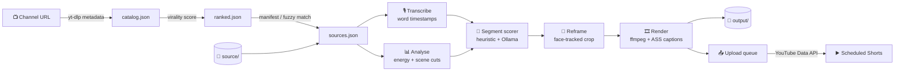

<div align="center">

# 🎬 YT Shorts Pipeline

**Turn a channel's long-form videos into ranked, captioned, subject-tracked 9:16 Shorts — fully local, one command.**

[](https://www.python.org/)
[](https://ffmpeg.org/)
[](https://github.com/ml-explore/mlx-examples)
[-white?logo=ollama&logoColor=black)](https://ollama.com/)
[-lightgrey?logo=apple)](#requirements)

</div>

---

## ✨ What it does

Point it at a YouTube channel and a folder of your long-form masters. The pipeline will:

1. **Catalog & rank** the channel's uploads by a composite *virality score* (view velocity, total views, like ratio, comment ratio).
2. **Match** the top-N videos to local source files (manifest → ID-in-filename → fuzzy title match), optionally downloading what's missing.
3. **Transcribe** with word-level timestamps (Whisper on Apple Metal via `mlx-whisper`, CPU fallback via `faster-whisper`).
4. **Analyse** the audio energy curve and detect scene cuts.
5. **Find the best moments** with a heuristic scorer (hook, engagement, payoff, length) and an optional **local LLM re-rank** through Ollama.
6. **Reframe to 9:16** with face-tracked smart cropping (YuNet / Haar), falling back to a blurred pillarbox when subjects aren't on screen.
7. **Render** 1080×1920 clips with word-highlight captions, a hook banner, an end CTA and loudness-normalised audio.
8. **Queue & upload** to YouTube via the Data API v3 with spaced-out scheduled publishing.

Everything runs on your machine. No cloud transcription, no paid APIs — the only network calls are to YouTube itself.

---

## 🗺️ Pipeline overview



---

## 📦 Requirements

| Dependency | Why | Install |
|---|---|---|
| **Python 3.10+** | runtime | `brew install python` |
| **ffmpeg / ffprobe** | decoding, scene detection, rendering | `brew install ffmpeg` |
| **Ollama** *(optional)* | local LLM re-ranking of clip candidates | `brew install ollama && ollama pull llama3.1:8b` |
| **Google Cloud OAuth client** *(optional)* | uploading to YouTube | see [Uploading](#-uploading-to-youtube) |

> **Apple Silicon** gets hardware-accelerated decode (`videotoolbox`) and Metal-backed Whisper automatically. Everything also works on Intel/Linux via the CPU fallbacks — just slower.

---

## 🚀 Quick start

```bash
git clone https://github.com/MuhammadBilalQamar/yt-shorts-pipeline.git
cd yt-shorts-pipeline/shorts-pipeline

# 1. Python environment
python3 -m venv .venv
.venv/bin/pip install -r requirements.txt

# 2. Drop your long-form masters in ./source
mkdir -p source && cp /path/to/masters/*.mp4 source/

# 3. Edit config.yaml (channel URL, top_n, etc.)

# 4. Run the whole thing
./shorts run
```

`./shorts` is a thin wrapper around `.venv/bin/python -m pipeline.cli`, so you never need to activate the venv.

Rendered Shorts land in `output/<video_id>/`, each with an `.mp4`, a poster `.jpg` and a `.json` of metadata (title, description, scores, reframe info).

---

## 🧭 Commands

```
./shorts [-c CONFIG] [-v] <command> [options]
```

| Command | What it does |
|---|---|
| `catalog [--limit N] [--show N]` | Fetch channel metadata with yt-dlp and rank it |
| `rank [--show N]` | Re-rank the cached catalog (e.g. after changing weights) |
| `match [--top N] [--download]` | Map ranked videos to local files; `--download` fetches missing ones |
| `process [--local] [--source DIR] [--only ID…] [--top N] [--force]` | Transcribe → analyse → score → cut → render the matched videos |
| `run [--limit N] [--top N] [--download] [--force] [--upload N]` | `catalog → rank → match → process` and optionally upload N clips |
| `queue` | Show the upload queue |
| `upload [--limit N] [--dry-run] [--no-schedule]` | Upload pending Shorts from the queue |
| `whoami` | Show which YouTube channel the OAuth token belongs to |

### Common workflows

**End-to-end for the top 10 videos, then upload 3:**
```bash
./shorts run --top 10 --upload 3
```

**I just have a folder of videos — skip YouTube metadata entirely:**
```bash
./shorts process --local --source ~/Movies/raw
```

**Re-cut a single video after tweaking segment settings:**
```bash
./shorts process --only dQw4w9WgXcQ --force
```

**Preview what would be uploaded without touching YouTube:**
```bash
./shorts upload --dry-run
```

---

## ⚙️ Configuration

All behaviour lives in [`shorts-pipeline/config.yaml`](shorts-pipeline/config.yaml). Every value has an inline comment; the highlights:

<details>
<summary><b>channel</b> — which channel, how many videos</summary>

```yaml
channel:
  url: "https://www.youtube.com/@MrBeast"
  handle: "@MrBeast"
  catalog_limit: 300   # most-recent uploads to scan
  top_n: 10            # videos that get clipped
```
</details>

<details>
<summary><b>ranking</b> — the virality score</summary>

```yaml
ranking:
  weights:
    views_per_day: 0.45   # velocity: views / days since upload
    views_total:   0.25
    like_ratio:    0.15
    comment_ratio: 0.15
  min_age_days: 3         # velocity is noisy in the first days
  min_duration_sec: 180   # skip existing Shorts
```
Each component is log-scaled and min-max normalised across the catalog before weighting, so one billion-view outlier doesn't flatten everything else.
</details>

<details>
<summary><b>sources</b> — matching local files</summary>

```yaml
sources:
  allow_download: false       # yt-dlp fallback for videos with no local file
  match_threshold: 0.72       # fuzzy title → filename ratio
```
Matching order: `source/manifest.csv` (`video_id,filename`) → YouTube ID anywhere in the filename → fuzzy title match.
</details>

<details>
<summary><b>transcribe</b> — Whisper backend</summary>

```yaml
transcribe:
  mlx_model: "mlx-community/whisper-large-v3-turbo"   # Apple Silicon
  faster_whisper_model: "small"                       # CPU fallback
  language: "en"
```
</details>

<details>
<summary><b>segments</b> — clip length and selection</summary>

```yaml
segments:
  min_len: 28
  target_len: 42
  max_len: 58
  llm_candidates: 12    # candidates sent to the LLM per video
  clips_per_video: 3    # Shorts kept per video
  min_gap: 20           # seconds between clips from the same video
```
</details>

<details>
<summary><b>llm</b> — optional Ollama re-rank</summary>

```yaml
llm:
  enabled: true
  provider: "ollama"
  host: "http://localhost:11434"
  model: "llama3.1:8b"
```
The LLM scores each candidate on **hook**, **retention** and **standalone clarity**, and writes a punchy `hook_line` and a `title`. If Ollama is unreachable or the model isn't pulled, the pipeline logs a warning and uses the heuristic ranking alone — it never blocks.
</details>

<details>
<summary><b>render</b> — output look and feel</summary>

```yaml
render:
  width: 1080
  height: 1920
  fps: 30
  mode: "auto"                   # auto | crop | blur
  crop_min_face_coverage: 0.55   # below this → blur mode
  crop_smoothing_sec: 1.2
  codec: "libx264"               # h264_videotoolbox for ~5x faster encodes
  crf: 18
  audio_lufs: -14
  captions:
    font: "Arial Black"
    size: 78
    words_per_line: 3
    highlight_color: "&H0000F0FF"  # ASS BGR — yellow
    margin_v: 420                  # keeps text above the Shorts UI
    hook_banner: true
  cta:
    enabled: true
    seconds: 2.0
    text: "Full video on {handle}"
```
</details>

<details>
<summary><b>upload</b> — YouTube publishing</summary>

```yaml
upload:
  client_secret: "./secrets/client_secret.json"
  token_file: "./secrets/token.json"
  privacy: "private"          # private | unlisted | public
  category_id: "24"           # Entertainment
  schedule_gap_min: 180       # minutes between scheduled publishes
  tags: ["shorts", "mrbeast"]
  description_template: |
    {hook}

    Watch the full video: {video_url}

    #shorts
```
</details>

Pass an alternate file with `./shorts -c other.yaml …` to keep per-channel configs.

---

## 🧠 How clip selection works

The scorer slides over sentence-level transcript units and evaluates every window between `min_len` and `max_len` seconds:

| Signal | Weight | What it rewards |
|---|---|---|
| **Hook** | 0.35 | Numbers, questions, strong openers, high audio energy in the first 3 s; penalises mid-thought starts |
| **Engagement** | 0.35 | Energetic speech pace, exclamations, reactions, tension words, healthy cut rate; penalises dead air |
| **Payoff** | 0.15 | Clean sentence ending, rising energy toward the end, a reaction or mild cliffhanger |
| **Length** | 0.15 | Gaussian around `target_len` |

The top `llm_candidates` non-overlapping windows go to Ollama for a second opinion; the final score is a 50/50 blend of heuristic and LLM. Out-points are then snapped to the nearest scene cut so clips end on an edit rather than mid-frame.

---

## 🎥 Smart reframing

For each clip the pipeline samples frames at 5 fps, detects faces (YuNet ONNX, auto-downloaded to `models/`; Haar cascade fallback), and builds a smoothed horizontal camera path:

- Tracks the largest face; if a second face is nearby, centres between them.
- Smooths **within shots only**, so the crop snaps at scene cuts instead of panning across them.
- If faces are visible in fewer than `crop_min_face_coverage` of frames, it switches to **blur mode**: the full frame is letterboxed over a blurred, darkened copy of itself.

The path is baked into a single ffmpeg `crop` expression, so rendering is one pass.

---

## 📤 Uploading to YouTube

1. In [Google Cloud Console](https://console.cloud.google.com/), create a project and enable the **YouTube Data API v3**.
2. Create an **OAuth client ID** of type **Desktop app** and download the JSON.
3. Save it as `shorts-pipeline/secrets/client_secret.json`.
4. Run `./shorts whoami` — a browser window opens for consent, and the token is cached at `secrets/token.json`.
5. Upload: `./shorts upload --limit 5`

With `privacy: private` (the default), uploads are **scheduled** starting 30 minutes from now and spaced `schedule_gap_min` apart, so a batch drains onto the channel over time. Use `--no-schedule` to publish immediately. The queue (`work/queue.json`) is sorted by score and remembers what's already been uploaded, so re-running is safe.

> The YouTube API quota allows roughly 6 uploads per day on a default project. Request a quota increase if you need more.

---

## 📁 Project layout

```
shorts-pipeline/
├── shorts                 # CLI wrapper (./shorts <cmd>)
├── config.yaml            # all settings
├── requirements.txt
├── pipeline/
│   ├── cli.py             # argparse entry point and command orchestration
│   ├── catalog.py         # yt-dlp metadata fetch + virality ranking
│   ├── sources.py         # local file matching / optional download
│   ├── transcribe.py      # mlx-whisper / faster-whisper with word timestamps
│   ├── analyze.py         # audio energy curve + scene-cut detection
│   ├── segments.py        # heuristic scorer + Ollama re-rank
│   ├── reframe.py         # face-tracked 9:16 camera path
│   ├── captions.py        # ASS subtitles: word highlight, hook banner, CTA
│   ├── render.py          # ffmpeg render + metadata sidecar
│   ├── upload.py          # queue + YouTube Data API uploader
│   └── common.py          # config, paths, logging, ffprobe helpers
├── bg-effects/            # stock SFX (beats, suspense, thunder, …)
├── source/                # your long-form masters  (git-ignored)
│   └── manifest.csv       # optional video_id,filename mapping
├── work/                  # caches: transcripts, analysis, segments, queue  (git-ignored)
├── output/                # rendered Shorts  (git-ignored)
├── models/                # auto-downloaded face detector  (git-ignored)
└── secrets/               # OAuth client + token  (git-ignored)
```

Every stage caches its result under `work/`, so re-running only redoes what's missing. Use `--force` to recompute.

---

## 🛠️ Troubleshooting

| Symptom | Fix |
|---|---|
| `No matched sources. Run catalog then match first` | Run `./shorts catalog && ./shorts match`, or use `process --local` |
| `N ranked videos have no local file` | Add rows to `source/manifest.csv`, rename files to include the video ID, or pass `--download` |
| `Ollama not reachable; using heuristic ranking only` | `ollama serve` and `ollama pull llama3.1:8b`, or set `llm.enabled: false` |
| Renders are slow | Set `render.codec: h264_videotoolbox` on Apple Silicon |
| Captions overlap the Shorts UI | Increase `render.captions.margin_v` |
| Crop jitters or misses the subject | Raise `crop_smoothing_sec`, or set `render.mode: blur` |
| `Missing OAuth client secret` | Follow [Uploading to YouTube](#-uploading-to-youtube) |
| Font not found in captions | Change `render.captions.font` to a font installed on your system |

Add `-v` to any command for debug-level logs including the exact ffmpeg invocations.

---

## 📄 License

No license has been specified yet. All rights reserved by the author until one is added.
